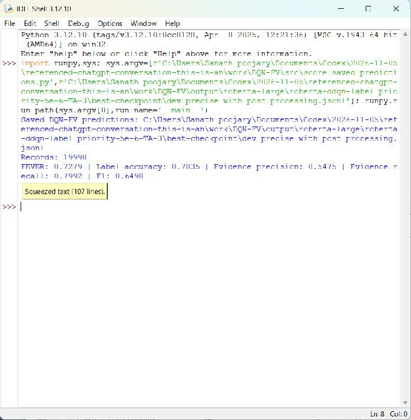

# DQN-FV: Precise Evidence for Fact Verification

This repository contains the DQN-FV research implementation and FEVER 1.0 datasets from the [original project](https://github.com/sysulic/DQN-FV), associated with the ACL 2021 paper *A DQN-based Approach to Finding Precise Evidences for Fact Verification*.

## Quick validation

The included FEVER development set can be checked without installing machine-learning packages. Python 3.9 or later is recommended for this utility.

```powershell
python src/validate_dataset.py data/fever/shared_task_dev.jsonl
```

```bash
python3 src/validate_dataset.py data/fever/shared_task_dev.jsonl
```

The validator checks each JSONL record for valid JSON, required `id`, `claim`, and FEVER `label` fields, non-empty claims, valid labels, and list-shaped evidence when present. To validate another split, pass its JSONL path.

## Successful execution

The development split contains 19,998 records, with 6,666 examples per label:


## Score the saved DQN-FV development predictions

The original project's public [Google Drive folder](https://drive.google.com/drive/folders/1armZDd2fch8RFH09rfswAIwbdsx_c2QW) contains `data.zip` and `checkpoints.zip`. After extracting `checkpoints.zip` into the repository root, score the archived development predictions with:

```bash
python src/score_saved_predictions.py output/roberta-large/roberta-ddqn-label_priority-5e-6-TA-3/best-checkpoint/dev_precise_with_post_processing.jsonl
```

The saved TA checkpoint predictions contain 19,998 records and score 0.7279 FEVER, 0.7835 label accuracy, 0.5475 evidence precision, 0.7992 evidence recall, and 0.6498 F1 with the repository's FEVER scorer. This command scores predictions produced by the archived checkpoint; it does not run new model inference.

Successful scorer output:

```text
Records: 19998
FEVER: 0.7279 | Label accuracy: 0.7835 | Evidence precision: 0.5475 | Evidence recall: 0.7992 | F1: 0.6498
```

Screenshot of the successful scorer run:



## Running model training and evaluation

The shell scripts in this repository reproduce the original research pipeline and expect a Linux or WSL environment, the historical Python/PyTorch/Transformers dependencies listed below, and additional artifacts that are not included in this checkout. In particular, full training and evaluation require:

- A Roberta-large model in `data/bert/roberta-large` (and, for the original recipe, its fine-tuned checkpoint).
- The FEVER SQLite knowledge-base database at `data/fever/fever.db`.
- Retrieval outputs in `data/retrieved/`, including the training and development ensemble JSONL files.
- Prepared DQN inputs in `data/dqn/`.
- A compatible trained checkpoint for evaluation.

These files are large or distributed separately by the original project. The included JSONL split files alone are not enough to run the complete DQN model. See [the original setup guide](https://github.com/sysulic/DQN-FV#dataset-preparation) for dataset sources. Once all prerequisites are installed and prepared, use the original scripts:

```bash
sh pretrained.sh  # optional: fine-tune the sentence encoder
sh train.sh       # train DQN-FV
sh dev.sh         # evaluate on the development set
sh test.sh        # evaluate on the test set
```

The original environment used Python 3.6.10, PyTorch 1.3.1, Transformers 2.5.1, and `prettytable`. Modern environments may require dependency and compatibility adjustments.

## Data files included

The repository includes `train.jsonl`, `shared_task_dev.jsonl`, and `shared_task_test.jsonl` under `data/fever/`. Model weights, SQLite database, retrieval results, and generated training data are excluded.

## Citation

```bibtex
@inproceedings{wan2021dqnfv,
  title={A DQN-based Approach to Finding Precise Evidences for Fact Verification},
  author={Wan, Hai and Chen, Haicheng and Du, Jianfeng and Luo, Weilin and Ye, Rongzhen},
  booktitle={Proceedings of the 59th Annual Meeting of the Association for Computational Linguistics},
  year={2021}
}
```


